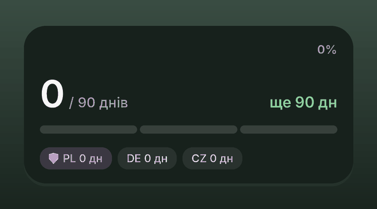
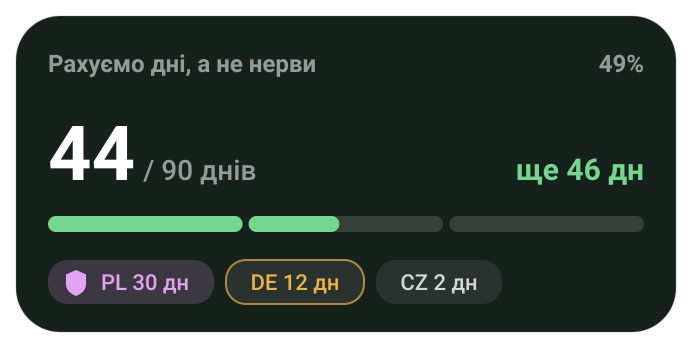
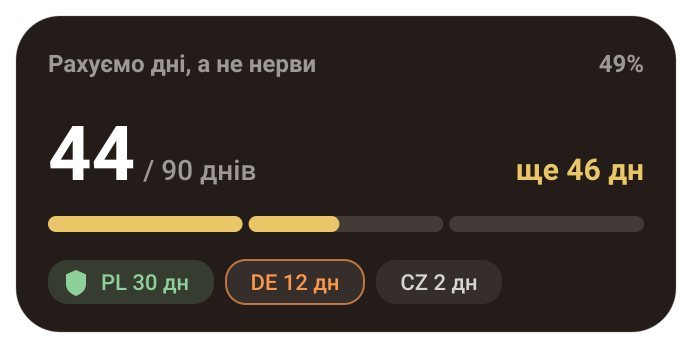
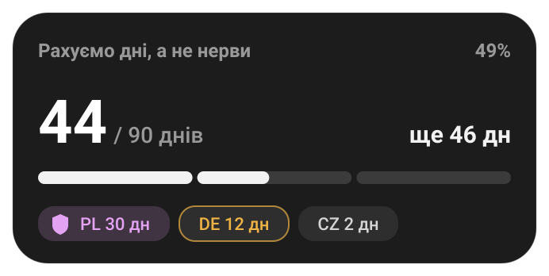
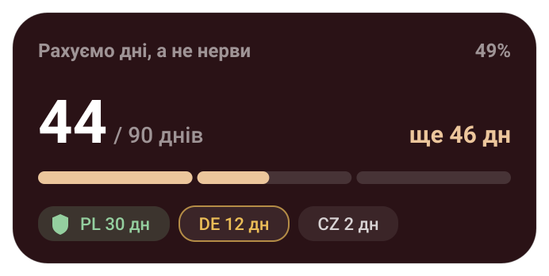
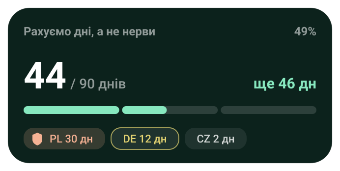
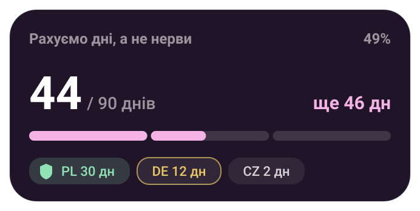
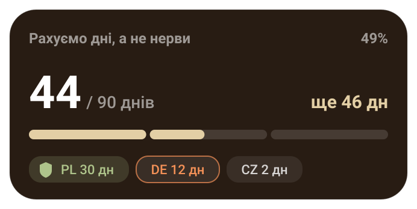
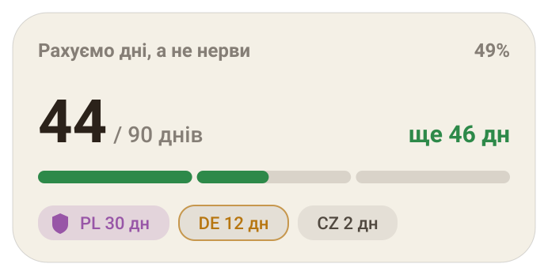
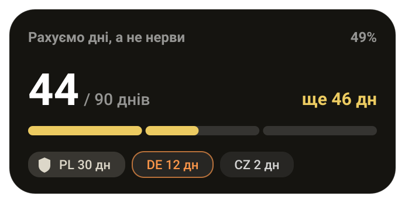

# EU 90 Days — віджет для Scriptable

Мінімалістичний віджет для iOS, який рахує 90 днів у ЄС, показує, скільки днів ти провів у кожній країні, і вміє ставити лічильник на паузу в країні тимчасового захисту.



**[Завантажити EU90Days.js](https://raw.githubusercontent.com/skatray/eu90days/main/EU90Days.js)** · [Як додати на телефон](#додати-скрипт-на-телефон)

## Можливості

- **Лічильник без дати початку.** Вводиш, скільки днів уже минуло, далі віджет сам додає +1 щодня.
- **Країна тимчасового захисту (необов'язково).** У ній головний лічильник стоїть на паузі, а дні рахуються в окремій плашці зі щитом.
- **Геолокація двічі на день.** Віджет визначає країну приблизно раз на 12 годин і веде журнал днів по країнах.
- **Дні по країнах.** Плашки на віджеті, поточна країна підсвічена.
- **Живі фрази й віхи.** Щоденна фраза за етапом, привітання на добу після перетину кордону, віхи на 30, 45 і 60 днів.
- **Дев'ять кольорових тем**, у тому числі світла. Див. розділ «Теми».

## Теми

Кольори підібрані в OKLCH: однакова світлота й насиченість, різні відтінки. Шкала «добре → увага → ліміт» змінює колір прогрес-бара на 60% і 85%, окремий колір віддано країні тимчасового захисту. Вибір теми: меню скрипта → «Кольорова тема».

<table>
<tr>
<td align="center"><br>Ліс</td>
<td align="center"><br>Захід сонця</td>
<td align="center"><br>Графіт</td>
</tr>
<tr>
<td align="center"><br>Бордо</td>
<td align="center"><br>М'ята</td>
<td align="center"><br>Лаванда</td>
</tr>
<tr>
<td align="center"><br>Пустеля</td>
<td align="center"><br>Крем (світла)</td>
<td align="center"><br>Чорне золото</td>
</tr>
</table>

## Встановлення

1. Встанови [Scriptable](https://scriptable.app) з App Store.
2. Додай скрипт у Scriptable: [файл EU90Days.js](https://raw.githubusercontent.com/skatray/eu90days/main/EU90Days.js) або інсталятор, див. [«Додати скрипт на телефон»](#додати-скрипт-на-телефон).
3. Додай на головний екран віджет Scriptable розміру Medium, натисни на нього й обери скрипт `EU90Days`.
4. Дай Scriptable доступ до геолокації («Завжди»), інакше країна не визначатиметься.

## Додати скрипт на телефон

**Варіант 1: інсталятор (рекомендовано).** Копіюєш десяток рядків один раз, далі скрипт сам завантажує актуальну версію з GitHub.

1. У Scriptable натисни «+», встав код нижче й назви скрипт `Install EU90`.
2. Запусти його. Він збереже скрипт як `EU90Days`.
3. Щоб оновитись пізніше, запусти інсталятор ще раз.

```js
const SRC = "https://raw.githubusercontent.com/skatray/eu90days/main/EU90Days.js";
const code = await new Request(SRC).loadString();
if (!code.includes("Scriptable")) throw new Error("Unexpected response");
let fm;
try { fm = FileManager.iCloud(); fm.documentsDirectory(); } catch (e) { fm = FileManager.local(); }
fm.writeString(fm.joinPath(fm.documentsDirectory(), "EU90Days.js"), code);
const a = new Alert();
a.title = "Done";
a.message = "EU90Days installed. Open it in Scriptable.";
a.addAction("OK");
await a.present();
```

**Варіант 2: файл напряму.** [Відкрити EU90Days.js](https://raw.githubusercontent.com/skatray/eu90days/main/EU90Days.js). У Safari довго утримуй посилання → «Завантажити пов'язаний файл», потім у «Файлах» поділись файлом у Scriptable або перемісти його в `iCloud Drive → Scriptable`.

> Файл збережено в UTF-8. Якщо на телефоні замість кирилиці з'являються кракозябри, скористайся інсталятором (варіант 1): він завантажує файл напряму як UTF-8.

## Налаштування

Запусти скрипт усередині Scriptable, з'явиться меню:

| Пункт | Що робить |
| --- | --- |
| Вказати, скільки днів минуло | Задає поточне значення лічильника |
| Обрати країну тимчасового захисту | Необов'язково, є варіант «Немає» |
| Оновити геолокацію зараз | Примусове оновлення країни |
| Переглянути віджет | Попередній перегляд |
| Додати минулі дні для країни | Додає дні, проведені до встановлення віджета |
| Скинути журнал країн | Очищає журнал |
| Завантажити тестові дані | Демо-дані для перегляду дизайну |
| Кольорова тема | Вибір теми |

Швидкий спосіб: у Widget Parameter можна вписати число, наприклад `44`. Воно застосовується лише коли змінюється.

## Приватність

Усе зберігається локально на телефоні (файл `eu90_state.json` у документах Scriptable). Геолокація використовується лише для визначення країни, жодні дані нікуди не надсилаються.

## Обмеження

- Віджети iOS статичні: анімації тільки в демо-гіфці.
- iOS сам вирішує, коли оновлювати віджет, тому «двічі на день» не гарантовано, а лише обмежено знизу кешем у 12 годин.
- Дні без геоданих рахуються як звичайні (обережно). Дні в країні захисту, коли пауза активна, не рахуються.
- Це допоміжний інструмент, а не юридична консультація. Правила перебування залежать від твого статусу, перевіряй їх в офіційних джерелах.

## Подяка

Ідея з посту [a.brodovoi](https://www.threads.net/@a.brodovoi) про віджет для трекінгу 90 днів у ЄС.
